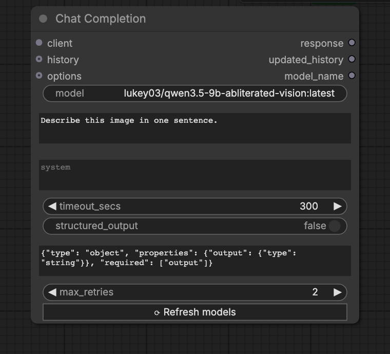
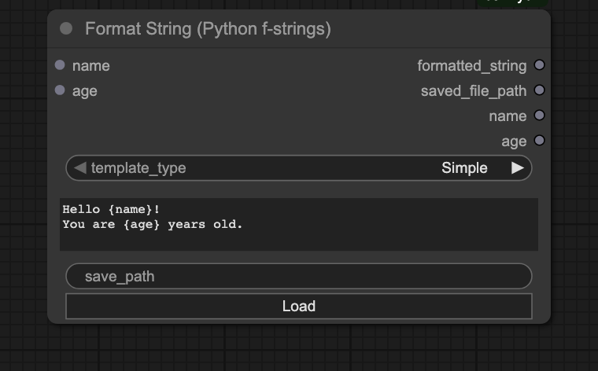
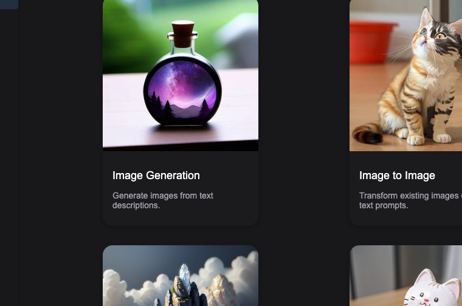
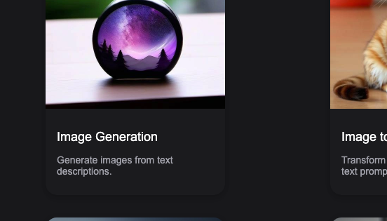
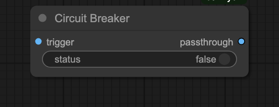
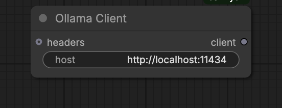
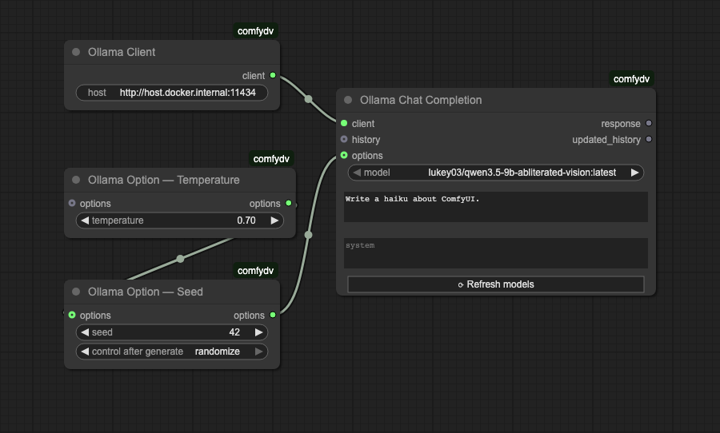
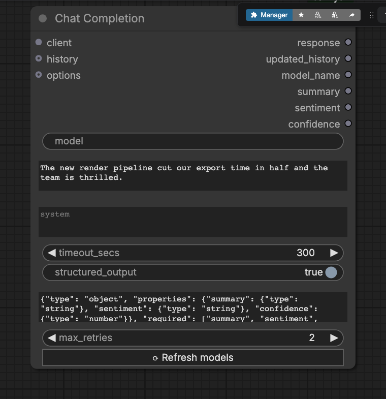
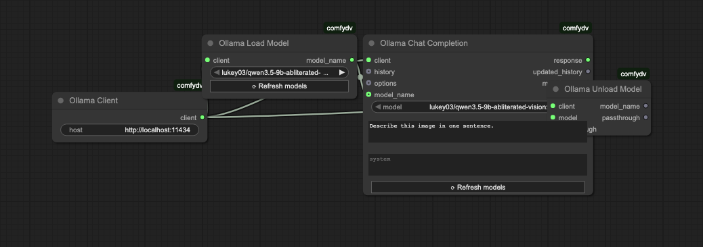
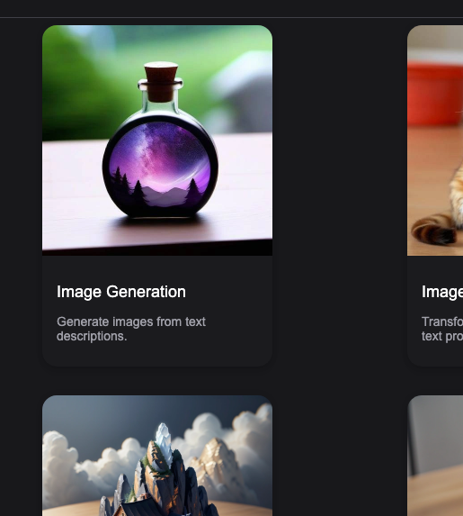

# comfydv

**Quality-of-life nodes for ComfyUI.**



## What is this

comfydv is a node pack for [ComfyUI](https://github.com/comfyanonymous/ComfyUI). It is for ComfyUI users, and you do not need to know Python to use it. It has two parts:

- **Utility nodes.** Format String builds text from a template and adds an input socket for each variable as you type. Random Choice selects one input with a seed. Circuit Breaker stops a queue run cleanly.
- **Local LLM nodes.** They chat with a model on your own computer, through [Ollama](https://ollama.com) or [llama.cpp](https://github.com/ggml-org/llama.cpp). One client node selects the backend, and all the other nodes operate with both.

Each node has unit tests. The tests of the LLM nodes also run against a real Ollama server.

## What you can do

| Task | Node or command | Section |
|---|---|---|
| Install comfydv | ComfyUI Manager: search for `comfydv` | [Install](#install) |
| Build text from a template | **Format String** | [Build text from a template](#build-text-from-a-template) |
| Select one input at random | **Random Choice** | [Select one input at random](#select-one-input-at-random) |
| Stop a run when a check fails | **Circuit Breaker** | [Stop a run when a check fails](#stop-a-run-when-a-check-fails) |
| Chat with a local model | **Ollama Client** → **Chat Completion** | [Chat with a local model](#chat-with-a-local-model) |
| Get typed fields from a model | **Chat Completion** with `structured_output` | [Get typed fields from a model](#get-typed-fields-from-a-model) |
| Ask a model about an image | **Chat Completion** with `image` | [Ask a model about an image](#ask-a-model-about-an-image) |
| Load and unload a model | **LLM Load Model** → **LLM Unload Model** | [Control model memory](#control-model-memory) |
| Change how the model generates text | **Ollama Option** nodes | [Change how the model generates text](#change-how-the-model-generates-text) |
| Continue a conversation | `updated_history` → `history` | [Continue a conversation](#continue-a-conversation) |
| Use llama.cpp | **LlamaCpp Client** | [Use llama.cpp instead of Ollama](#use-llamacpp-instead-of-ollama) |
| Connect to a server that needs a password | **Ollama Header** nodes | [Connect to a server that needs a password](#connect-to-a-server-that-needs-a-password) |
| Open an old workflow | Replace each old node with the new node from the table | [Open a workflow from an older version](#open-a-workflow-from-an-older-version) |
| Control telemetry | Set an environment variable | [Control telemetry](#control-telemetry) |

## Install

**With ComfyUI Manager** (recommended): search for `comfydv`. Click **Install**.

**By hand:**

```bash
cd /path/to/ComfyUI/custom_nodes
git clone https://github.com/darth-veitcher/comfydv.git
```

Restart ComfyUI. The nodes are in the node menu under **dv/string_operations**, **dv/utils**, **dv/ollama** and **dv/llamacpp**.

ComfyUI Manager installs the Python packages from `requirements.txt`: `jinja2`, `pydantic`, `pydantic-ai-slim` and `pydantic-ai-harness`. After you install by hand, run this command with the Python of ComfyUI:

```bash
pip install -r custom_nodes/comfydv/requirements.txt
```

The LLM nodes need a backend that you install yourself:

- **Ollama**: [install Ollama](https://ollama.com/download). Start it with `ollama serve`. Download a model with `ollama pull qwen2.5:latest`.
- **llama.cpp**: [build or install `llama-server`](https://github.com/ggml-org/llama.cpp). Start it in router mode, as [Use llama.cpp instead of Ollama](#use-llamacpp-instead-of-ollama) shows.

## Quickstart

This example builds a prompt from a template. It needs no LLM backend.

1. Right-click the canvas.
2. Select **Add Node** → **dv** → **string_operations** → **Format String (Python f-strings)**.
3. Set `template_type` to **Simple**.
4. Type `A photo of {subject} in the style of {style}` in `template`.
5. Find the two new inputs, `subject` and `style`, on the node.
6. Type `a red fox` in `subject` and `watercolour` in `style`.
7. Click **Queue**.

The node shows `A photo of a red fox in the style of watercolour`. The `formatted_string` output gives the same text to the next node. To send it to a model, connect it to the `prompt` input of **Chat Completion** (see [Chat with a local model](#chat-with-a-local-model)).

The full documentation, with the inputs and outputs of each node, is at **[darth-veitcher.github.io/comfydv](https://darth-veitcher.github.io/comfydv/stable/)**.

## Build text from a template

Type a template in **Format String**. Write each variable as `{variable_name}` in **Simple** mode, or as `{{ variable_name }}` in **Jinja2** mode. The node adds an input socket for each variable as you type.



| Output | Content |
|---|---|
| `formatted_string` | The text that the template makes |
| `saved_file_path` | The JSON file with the template and the input values, in the ComfyUI output directory. It is empty if you did not set `save_path` or if the save failed. |
| One output for each variable | The value of that input, as text, so that you can connect it to more nodes |

Set `template_type` to **Jinja2** to use filters (`| upper`, `| int`), conditions and loops. Jinja2 templates run in a sandbox. A template can use only its variables, the filters, `now()`, `fromjson` and the `datetime`, `random` and `math` modules.



## Select one input at random

Connect two or more inputs of the same type to **Random Choice**. The type can be images, text, conditioning or any other ComfyUI type. The node gives one of them.



The `seed` input controls the selection:

- `seed = 0` gives a new random selection on each run.
- Any other value gives the same selection on each run, so you can repeat a result.

When you disconnect an input, the node removes the empty input socket.

## Stop a run when a check fails

**Circuit Breaker** stops the current queue run cleanly when a condition is false. Use it to stop before a node that would fail on bad input.



1. Connect an image to `trigger`.
2. Connect a boolean to `status`.

If `status` is `false`, the node raises `InterruptProcessingException`, and ComfyUI stops the run with no error dialog. If `status` is `true`, the node gives the image to the next node, unchanged.

For example, a quality-check node can set `status` to `false` when the draft is already good. Then the run skips a slow upscale.

## Chat with a local model



1. Add **Ollama Client** and set `host`. The default is `http://localhost:11434`.
2. Add **LLM Model Selector** and select a model from the list. Click **⟳ Refresh models** to get the current list from the server. Or type a model name in the `model` input of **Chat Completion**.
3. Add **Chat Completion**. Connect `client`, `model` and `prompt`.
4. Click **Queue**.


The node shows the response, and the `response` output gives it to the next node. The other outputs are:

| Output | Content |
|---|---|
| `updated_history` | The conversation so far, for the next **Chat Completion** |
| `model_name` | The model that answered |
| `seed_used` | The seed of the attempt that succeeded. Use it to repeat a result. |

A complete graph looks like this:



Two inputs control how long the node waits:

- `timeout_secs` (30 to 3600, default 300) is the time limit of one request. Retry N gets N + 1 times `timeout_secs`. For example, the first retry of a 300-second limit gets 600 seconds.
- `max_retries` (0 to 5, default 2) is the number of retries. A retry occurs after an empty response, a response that is not valid, or a refusal (when **Refusal Retry** is on). 0 means one attempt only. Each retry uses a new seed.

If the server is not available, the node shows an error that names the host.

## Get typed fields from a model

Set `structured_output` to `true` on **Chat Completion**. Then write a JSON Schema in `output_schema`. A JSON Schema is a description of the fields that you want and of their types.

```json
{"type": "object", "properties": {"subject": {"type": "string"}, "count": {"type": "integer"}}, "required": ["subject"]}
```

The node adds one output for each field, with a ComfyUI type: `STRING`, `INT`, `FLOAT` or `BOOLEAN`. The `response` output gives all the fields as one JSON text. If the model does not give a valid value for each required field, the node retries. After the last retry, it stops with an error.



## Ask a model about an image

Connect an `IMAGE` to the `image` input of **Chat Completion**. A vision model can then describe the image, answer questions about it or read its text. A vision model is a model that accepts images.

- **Ollama**: use a vision model, for example a llava model.
- **llama.cpp**: start `llama-server` with the projector file of the model: `--mmproj <projector.gguf>`.

The image input operates the same on both backends. You can use it with structured output, with history and with the option nodes. A batch of images goes to the model as more than one image in the same message. If you do not connect `image`, the node sends only text.

## Control model memory

On a computer with one GPU, a model can use the VRAM that your image pipeline needs. Use these two nodes to control when a model is in memory:

- **LLM Load Model** loads a model into memory.
- **LLM Unload Model** removes the model from memory immediately.



Connect the nodes in this sequence. The connections make ComfyUI run them in this order:

1. Connect `LLMLoadModel.model_name` to `ChatCompletion.model`. Then the model loads before the chat starts.
2. Connect `ChatCompletion.model_name` to `LLMUnloadModel.model`. Then the model unloads after the chat ends.
3. Optional: connect `ChatCompletion.response` to `LLMUnloadModel.passthrough`. Then the unload node gives the response to the next node, unchanged.

## Change how the model generates text

Connect one or more **Ollama Option** nodes in a chain. Connect the chain to the `options` input of **Chat Completion**. The column "Backends" shows where each option has an effect. The column "Parameter" gives the name to use in **Extra Body**.



| Option node | Parameter | Default (range) | What a value means | Backends |
|---|---|---|---|---|
| Temperature | `temperature` | 0.8 (0 to 2) | Lower gives more predictable text. Higher gives more varied text. | Ollama |
| Seed | `seed` | 0 | A fixed seed with the same input gives the same output. | Ollama (llama.cpp: retries only) |
| Max Tokens | `num_predict` | 512 (1 to 131072) | The maximum length of the response, in tokens. | Ollama |
| Top P | `top_p` | 0.9 (0 to 1) | Lower makes the model select only from its most probable words. | Ollama |
| Top K | `top_k` | 40 (0 to 100) | The number of most probable words that the model selects from. | Ollama |
| Repeat Penalty | `repeat_penalty` | 1.1 (0 to 2) | Higher makes the model repeat itself less. | Ollama |
| Disable Thinking | `think` | on | On: a thinking model answers without its reasoning step. This is faster. | Both |
| Refusal Retry | `refusal_retry` | on | Retries with a new seed when the response looks like a refusal. | Both |
| Extra Body | any | `{}` | Your own JSON values, added to the options. | Ollama |

**Refusal Retry** finds refusals with a list of known phrases. You can add your own phrases in `custom_phrases`, separated by commas.

To also find refusals that do not use those phrases, set `embedding_model` to an embedding model, for example `nomic-embed-text`. Use a different model from the chat model. The node then compares the response with known refusals. A response with a similarity higher than `threshold` (default 0.82, range 0 to 1) is a refusal. A lower `threshold` finds more refusals and also more false refusals.

## Continue a conversation

**Chat Completion** gives the conversation in `updated_history`. It is an `OLLAMA_HISTORY` list of messages, each with a `role` and a `content`. Connect `updated_history` to the `history` input of the next **Chat Completion** to continue the conversation.

To examine a conversation, use **Ollama Debug History**, which shows the messages as text, or **Ollama History Length**, which counts them.

## Use llama.cpp instead of Ollama

Replace **Ollama Client** with **LlamaCpp Client**. Its default `host` is `http://localhost:8080`. You do not change any other node.

llama.cpp must run in router mode. In router mode, `llama-server` loads models from a directory, not one model from `-m model.gguf`:

```bash
llama-server --models-dir ./models -c 8192
```

In router mode, llama.cpp also reports when a model is `loading` or `downloading`. Ollama reports only `loaded` or `unloaded`.

## Connect to a server that needs a password

Connect an **Ollama Header** node to the `headers` input of **Ollama Client** or **LlamaCpp Client**:

- **Ollama Header — Basic Auth**: a user name and a password.
- **Ollama Header — Bearer Token**: a token, for example an API key.
- **Ollama Header — Custom**: any header name and value.

You can connect more than one header node in a chain. All the nodes that use the client send the headers.

## Open a workflow from an older version

Some nodes have new names, so that their names do not depend on the backend. If ComfyUI reports a missing node type in an old workflow, add the new node and connect it again. The nodes operate as before.

| Old name | New name |
|---|---|
| `OllamaChatCompletion` | `ChatCompletion` |
| `OllamaModelSelector` | `LLMModelSelector` |
| `OllamaLoadModel` | `LLMLoadModel` |
| `OllamaUnloadModel` | `LLMUnloadModel` |
| `OLLAMA_CLIENT` socket | `LLM_CLIENT` socket |

`OllamaClient` has the same name. Connect its output to the new nodes again.

## Control telemetry

comfydv connects only to the servers in your graph. When it loads, it also connects to Ollama at `OLLAMA_HOST`, `host.docker.internal:11434` or `localhost:11434` to fill the model lists. Some of the libraries that it uses can send data or check for updates. comfydv turns these off when it loads, unless you set them yourself:

| Variable | comfydv default | Effect |
|---|---|---|
| `FASTMCP_TELEMETRY_MODE` | `off` | No OpenTelemetry trace data to MCP servers |
| `FASTMCP_CHECK_FOR_UPDATES` | `off` | No version check on PyPI |
| `FASTMCP_SHOW_SERVER_BANNER` | `false` | No start-up message on the console |
| `PYDANTIC_AI_NO_BANNER` | `1` | No first-run message on the console |

To turn one on again, set its variable before you start ComfyUI. For example, set `FASTMCP_TELEMETRY_MODE=native` and configure an OpenTelemetry SDK and exporter. Then the traces go to your own collector. These settings apply to all of the ComfyUI process, so other node packs also get them.

## Limits

- **Circuit Breaker** accepts only an `IMAGE` in `trigger`.
- **Random Choice** gives a random selection for `seed = 0`. You cannot use 0 as a fixed seed.
- The LLM nodes need a local Ollama or llama.cpp server. They do not connect to cloud model services.
- Structured output gives a typed output only for the top-level fields of the schema. A nested object or list comes out as JSON text.
- Valid structured output can still contain wrong content, especially from a small or a low-quality model.
- llama.cpp must run in router mode. A `llama-server` that loads one model with `-m` does not operate with these nodes.
- Image input needs a vision model, and llama.cpp also needs `--mmproj`.
- On llama.cpp, the sampling options (Temperature, Max Tokens, Top P, Top K, Repeat Penalty and Extra Body) have no effect. Set them when you start `llama-server`.
- On llama.cpp, the Seed node sets only the seeds of the retries.
- If another node pack loads FastMCP before comfydv, the telemetry defaults have no effect. To be sure, set the variables before you start ComfyUI.

## Technical notes

- **Python**: 3.11 or later.
- **Dependencies**: `pydantic-ai-slim[openai,mcp]` and `pydantic-ai-harness[codemode]` have exact version pins, because the harness requires the exact pydantic-ai version. `requirements.txt` is written by hand for ComfyUI Manager ([ADR-003](project-management/ADRs/ADR-003-requirements-txt-authoring-policy.md)).
- **HTTP**: the nodes use `aiohttp` to talk to Ollama ([ADR-004](project-management/ADRs/ADR-004-aiohttp-over-httpx-for-ollama.md)). The client node is the only place for the host and the headers ([ADR-005](project-management/ADRs/ADR-005-ollama-host-config-via-client-node.md)).
- **Backends**: one `LLMProvider` interface for Ollama and llama.cpp ([ADR-007](project-management/ADRs/ADR-007-llm-provider-adapter-pattern.md)). Images go on the message ([ADR-008](project-management/ADRs/ADR-008-multimodal-image-input-across-llmprovider-boundary.md)).
- **Structured output**: Ollama uses its native `/api/chat` endpoint, because its OpenAI-compatible endpoint resets the context size on each request ([ADR-009](project-management/ADRs/ADR-009-native-structured-output-mode.md)).
- **Disable Thinking**: each backend gets the setting in its own request format ([ADR-010](project-management/ADRs/ADR-010-disable-thinking-toggle.md)).
- **Telemetry**: [ADR-014](project-management/ADRs/ADR-014-telemetry-off-by-default.md).
- **Logging**: comfydv uses the standard `logging` module and is silent by default ([ADR-001](project-management/ADRs/ADR-001-stdlib-logging-over-console-libraries.md), [ADR-002](project-management/ADRs/ADR-002-nullhandler-pattern-for-library-loggers.md)).
- **All decisions**: [project-management/ADRs/](project-management/ADRs/README.md).
- **License**: [AGPL-3.0](LICENSE).

## Develop

Set up and run the checks:

```bash
uv sync
uv run ruff check && uv run ruff format --check
uv run ty check
uv run pytest -m "not integration and not system"
```

Integration tests need Ollama at `localhost:11434` (`just test-integration`). System tests need the Docker Compose harness (`just test-system`). To start ComfyUI with this repository mounted, run `just up`. Read [AGENTS.md](AGENTS.md) for the rules of the repository.

## Glossary

- **Backend**: the server that runs the model: Ollama or llama.cpp.
- **Embedding model**: a model that changes text into a list of numbers. Texts with a similar meaning get similar numbers.
- **Jinja2**: a template language with variables, filters, conditions and loops.
- **JSON Schema**: a standard description of the fields of a JSON value and of their types.
- **llama.cpp**: a program that runs models on your own computer. Its server is `llama-server`.
- **LLM (large language model)**: a model that reads and writes text.
- **MCP (Model Context Protocol)**: a standard way for a model to use tools on a server.
- **Node**: one box on the ComfyUI canvas.
- **Ollama**: a program that downloads models and runs them on your own computer.
- **OpenTelemetry**: a standard for trace data about what a program does.
- **Projector**: the file that lets a llama.cpp model accept images. `--mmproj` loads it.
- **PyPI**: the Python package index, where `pip` gets packages.
- **Queue run**: one run of a workflow, after you click **Queue**.
- **Router mode**: a llama.cpp mode that loads and unloads models from a directory.
- **Sandbox**: a restricted place to run code or templates, with no access to the rest of your computer.
- **Seed**: a number that sets the random choices. The same seed gives the same result.
- **Socket**: an input or an output point on a node.
- **Structured output**: a response that obeys a JSON Schema.
- **Thinking model**: a model that writes its reasoning before its answer.
- **Token**: a part of a word. A model counts its input and output in tokens.
- **Vision model**: a model that accepts images as well as text.
- **VRAM**: the memory on the GPU.
- **Workflow**: a graph of connected nodes. You can save it as a file.
